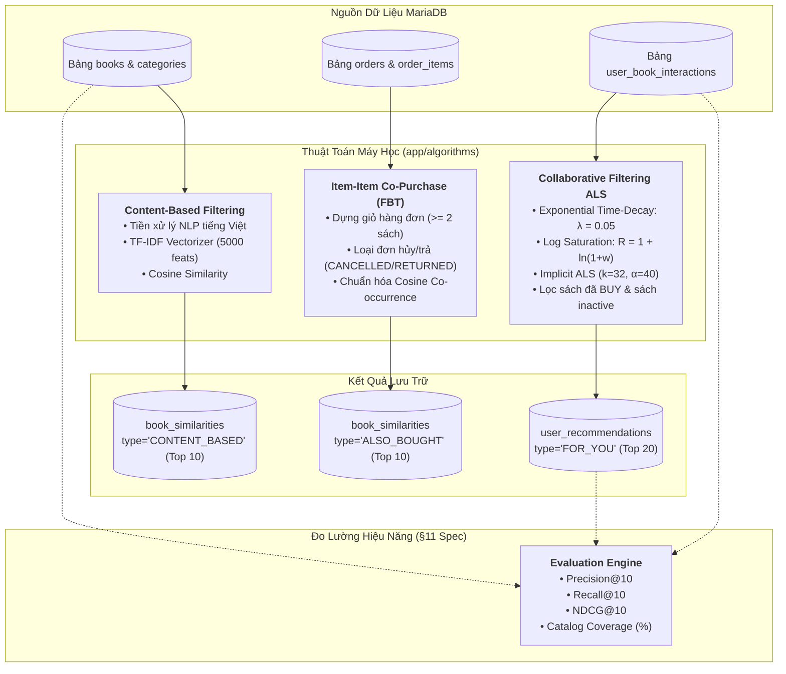

# 🤖 HƯỚNG DẪN VẬN HÀNH & KIẾN TRÚC RECSYS MICROSERVICE (`TT_Goi_y`)

> **Dự án:** Hệ thống E-Commerce Bán Sách BookRunner  
> **Module:** AI / Machine Learning Recommender System Microservice  
> **Công nghệ:** Python 3.11 - 3.13 / FastAPI / SQLAlchemy / Scikit-Learn / Implicit / SciPy / MariaDB / Uvicorn  
> **Tài liệu đặc tả toán học & thuật toán:** Xem chi tiết tại [`RECSYS_DOCUMENTATION.md`](./RECSYS_DOCUMENTATION.md)

---

## 📑 MỤC LỤC
1. [Giới Thiệu Tổng Quan](#1-giới-thiệu-tổng-quan)
2. [Cách Thức Hoạt Động Của Hệ Thống](#2-cách-thức-hoạt-động-của-hệ-thống)
   - [2.1. Content-Based Filtering (Sách tương tự)](#21-content-based-filtering-sách-tương-tự)
   - [2.2. Co-Purchase FBT (Thường được mua cùng)](#22-co-purchase-fbt-thường-được-mua-cùng)
   - [2.3. Collaborative Filtering ALS (Gợi ý cá nhân hóa)](#23-collaborative-filtering-als-gợi-ý-cá-nhân-hóa)
   - [2.4. Module Đo lường & Đánh giá Chất lượng Mô hình](#24-module-đo-lường--đánh-giá-chất-lượng-mô-hình)
3. [Cấu Trúc Thư Mục](#3-cấu-trúc-thư-mục)
4. [Yêu Cầu Môi Trường & Cài Đặt](#4-yêu-cầu-môi-trường--cài-đặt)
5. [Cấu Hình Biến Môi Trường (`.env`)](#5-cấu-hình-biến-môi-trường-env)
6. [Hướng Dẫn Khởi Chạy Chi Tiết](#6-hướng-dẫn-khởi-chạy-chi-tiết)
   - [Bước 1: Nạp Dữ Liệu Giả Lập (Seeder)](#bước-1-nạp-dữ-liệu-giả-lập-seeder)
   - [Bước 2: Khởi Động FastAPI Server](#bước-2-khởi-động-fastapi-server)
   - [Bước 3: Kiểm Tra Giao Diện Tài Liệu Swagger](#bước-3-kiểm-tra-giao-diện-tài-liệu-swagger)
   - [Bước 4: Kích Hoạt Huấn Luyện & Đánh Giá](#bước-4-kích-hoạt-huấn-luyện--đánh-giá)
7. [Danh Sách REST API Endpoints](#7-danh-sách-rest-api-endpoints)
8. [Xử Lý Lỗi Thường Gặp (Troubleshooting)](#8-xử-lý-lỗi-thường-gặp-troubleshooting)

---

## 1. GIỚI THIỆU TỔNG QUAN

`TT_Goi_y` là microservice chuyên biệt đảm nhiệm tính toán các thuật toán gợi ý (Machine Learning Recommendation System) cho nền tảng BookRunner.

### Vai trò trong hệ sinh thái:
* **Kiến trúc dữ liệu phân tán (Shared Database Pattern):** Cùng kết nối vào MariaDB (`book_runner_db`) với Spring Boot Backend (`book-runner`).
* **Tính toán ngoại tuyến (Batch / Offline Training):** Xử lý khối lượng tính toán ma trận nặng (TF-IDF, Co-Purchase Cosine, Implicit ALS) mà không làm tắc nghẽn luồng xử lý web chính của Spring Boot.
* **Ghi kết quả gợi ý vào Database:** Kết quả huấn luyện được ghi đè vào 2 bảng `book_similarities` và `user_recommendations` để Spring Boot phục vụ với tốc độ mili-giây (kết hợp Redis Cache).

```
┌──────────────────┐           ┌────────────────────┐           ┌──────────────────────┐
│  React Frontend  │ ◄───────► │ Spring Boot Server │ ◄───────► │ MariaDB Database     │
│  (Port 3000)     │           │ (Port 8080)        │           │ (book_runner_db)     │
└──────────────────┘           └────────────────────┘           └──────────┬───────────┘
                                         │ (Trigger Train/Eval)            │ (Đọc/Ghi dữ liệu)
                                         ▼                                 ▼
                               ┌───────────────────────────────────────────────────────┐
                               │       FastAPI RecSys Microservice (TT_Goi_y)          │
                               │                   (Port 8000)                         │
                               └───────────────────────────────────────────────────────┘
```

---

## 2. CÁCH THỨC HOẠT ĐỘNG CỦA HỆ THỐNG

Microservice vận hành theo mô hình **Hybrid Recommender System** kết hợp 3 thuật toán học máy và 1 module đo lường hiệu năng:



### 2.1. Content-Based Filtering (Sách tương tự)
* **File:** [`app/algorithms/content_based.py`](./app/algorithms/content_based.py)
* **Nguyên lý:** Phân tích nội dung siêu dữ liệu sách (Metadata Profiling):
  $$\text{Document}_i = (\text{Title} \times 2) + (\text{Author} \times 2) + (\text{Category} \times 3) + \text{Description}$$
* Tiêu đề và tác giả nhân đôi trọng số, thể loại nhân 3 để tăng tính phân biệt.
* Vector hoá qua `TfidfVectorizer` (5.000 từ vựng nổi bật nhất, ngram 1–2, loại Stopwords tiếng Việt).
* Tính ma trận Cosine Similarity giữa tất cả các cặp sách, loại bỏ chính mình, lấy Top 10 sách có điểm cao nhất ghi vào bảng `book_similarities` (`similarity_type = 'CONTENT_BASED'`).
* **Ưu điểm:** Giải quyết triệt để bài toán **Item Cold-Start** (sách mới nhập kho chưa ai xem hay mua vẫn có ngay sách tương tự).

### 2.2. Co-Purchase FBT (Thường được mua cùng)
* **File:** [`app/algorithms/co_purchase.py`](./app/algorithms/co_purchase.py)
* **Nguyên lý:** Khai phá dữ liệu giỏ hàng thực tế từ `order_items JOIN orders JOIN books`.
* Loại bỏ các đơn hàng trạng thái `CANCELLED` (đã hủy) và `RETURNED` (hoàn trả), chỉ xét sách đang mở bán (`active = 1`).
* Với các đơn hàng có $\ge 2$ sản phẩm, đếm tần suất đồng xuất hiện (Co-occurrence) của từng cặp $(A, B)$ và chuẩn hóa Cosine:
  $$\text{Score}(A, B) = \frac{\text{Count}(A, B)}{\sqrt{\text{Orders}(A) \times \text{Orders}(B)}}$$
* Giúp điểm số công bằng, không bị thiên vị cho các cuốn sách bán chạy đại trà.
* Lưu Top 10 sách mua kèm 2 chiều vào bảng `book_similarities` (`similarity_type = 'ALSO_BOUGHT'`).

### 2.3. Collaborative Filtering ALS (Gợi ý cá nhân hóa)
* **File:** [`app/algorithms/als_recommender.py`](./app/algorithms/als_recommender.py)
* **Nguyên lý:** Khai phá hành vi ngầm định của người dùng từ bảng `user_book_interactions`.
* **Hàm suy giảm thời gian (Time-Decay Exponential):**
  $$w(e) = w_{\text{base}} \times e^{-\lambda \times \Delta t} \quad (\lambda = 0.05, \text{chu kỳ bán rã } \approx 14 \text{ ngày})$$
  Hành vi vừa diễn ra hôm qua có giá trị hơn hành vi cách đây 2 tháng.
* **Hàm bão hòa Logarit (Log Saturation):**
  $$R_{ui} = 1 + \ln\left(1 + \sum w(e)\right)$$
  Triệt tiêu hiện tượng spam click (xem 50 lần không phá vỡ cân bằng mô hình).
* **Implicit ALS:** Huấn luyện ma trận thưa qua thư viện `implicit` ($factors = 32, iterations = 15, \alpha = 40, \lambda_{\text{reg}} = 0.1$).
* **Hậu xử lý:** Tự động loại bỏ các sách người dùng đã mua (`BUY`), loại bỏ sách ngừng kinh doanh (`active = false`), chọn Top 20 ghi vào `user_recommendations` (`recommendation_type = 'FOR_YOU'`).

### 2.4. Module Đo lường & Đánh giá Chất lượng Mô hình
* **File:** [`app/algorithms/evaluation.py`](./app/algorithms/evaluation.py)
* **Nguyên lý:** Hiện thực hóa chuẩn đo lường khoa học dữ liệu (Mục 11 `RECSYS_DOCUMENTATION.md`):
  1. **Precision@10:** Tỷ lệ sách gợi ý trùng khớp với tập hành vi kiểm thử (Hold-out test set).
  2. **Recall@10:** Tỷ lệ sách yêu thích được thuật toán tìm thấy thành công.
  3. **NDCG@10:** Đo lường thứ hạng vị trí (sách yêu thích xếp hạng 1, 2 tốt hơn xếp hạng 9, 10).
  4. **Catalog Coverage (%):** Độ phủ của kho sách (đảm bảo hệ thống không chỉ gợi ý quanh quẩn vài cuốn nổi tiếng mà khai thác được cả sách Long-Tail).

---

## 3. CẤU TRÚC THƯ MỤC

```
TT_Goi_y/
├── app/
│   ├── main.py                     # Entry point FastAPI, CORS & Swagger Docs
│   ├── config.py                   # Cấu hình Pydantic Settings đọc từ .env
│   ├── database.py                 # Kết nối MariaDB qua SQLAlchemy Engine & SessionLocal
│   ├── models/                     # Ánh xạ ORM MariaDB (khớp 100% với Spring Boot)
│   │   ├── book.py                 # Bảng 'books' & 'categories'
│   │   ├── interaction.py          # Bảng 'user_book_interactions'
│   │   └── recommendation.py       # Bảng 'book_similarities' & 'user_recommendations'
│   ├── algorithms/                 # Các thuật toán học máy cốt lõi
│   │   ├── content_based.py        # TF-IDF & Cosine Similarity
│   │   ├── co_purchase.py          # Item-Item Frequently Bought Together
│   │   ├── als_recommender.py      # Implicit ALS + Time-Decay Collaborative Filtering
│   │   └── evaluation.py           # Precision@K, Recall@K, NDCG@K & Catalog Coverage
│   ├── services/
│   │   └── training_service.py     # Lớp điều phối thực thi huấn luyện
│   └── api/
│       └── recsys_router.py        # Router API (/api/recsys/train/**, /evaluate, /health)
├── scripts/
│   ├── seed_synthetic_data.py      # Sinh dataset offline (JSON) 4.000+ tương tác & 90+ giỏ hàng FBT
│   └── cleanup_synthetic_db.py     # Script dọn sạch triệt để dữ liệu ảo từng nạp vào DB (nếu có)
├── data/
│   ├── synthetic_interactions.json # Dataset tương tác offline (tách biệt hoàn toàn khỏi DB)
│   └── synthetic_baskets.json      # Dataset giỏ hàng FBT offline
├── .env.example                    # File mẫu cấu hình kết nối DB
├── .env                            # File cấu hình môi trường thực tế (tự tạo)
├── requirements.txt                # Danh sách thư viện Python cần cài
├── RECSYS_DOCUMENTATION.md         # Toàn tập tài liệu đặc tả thuật toán chi tiết
└── README.md                       # Hướng dẫn khởi chạy & vận hành (File này)
```

---

## 4. YÊU CẦU MÔI TRƯỜNG & CÀI ĐẶT

### 4.1. Yêu cầu hệ thống:
* **Python:** Phiên bản `3.10` đến `3.13` (Khuyến nghị 3.11 hoặc 3.12 để tương thích tốt nhất với binary wheel của `scipy` và `implicit`).
* **Database:** MariaDB $\ge 10.6$ hoặc MySQL $\ge 8.0$ (chạy sẵn cơ sở dữ liệu `book_runner_db`).
* **C++ Build Tools (Nếu cài trên Windows):** Thư viện `implicit` được viết bằng Cython/C++. Nếu dùng Python 3.13 mà chưa có pre-built wheel, bạn cần cài **Visual Studio C++ Build Tools** hoặc tải wheel phù hợp.

### 4.2. Cài đặt từng bước:

1. **Mở terminal tại thư mục `TT_Goi_y`:**
   ```bash
   cd "TT_Goi_y"
   ```

2. **Khởi tạo môi trường ảo (Virtual Environment):**
   ```bash
   # Windows
   python -m venv venv
   .\venv\Scripts\activate

   # Linux / macOS
   python3 -m venv venv
   source venv/bin/activate
   ```

3. **Cài đặt các gói phụ thuộc:**
   ```bash
   pip install --upgrade pip
   pip install -r requirements.txt
   ```

---

## 5. CẤU HÌNH BIẾN MÔI TRƯỜNG (`.env`)

Tạo file `.env` tại thư mục gốc `TT_Goi_y/` bằng cách sao chép từ `.env.example`:

```bash
# Windows PowerShell
copy .env.example .env

# Linux / macOS
cp .env.example .env
```

Mở file `.env` và kiểm tra thông tin kết nối MariaDB (phải trùng khớp với `application.yaml` của `book-runner`):

```ini
# Cấu hình MariaDB
DB_HOST=localhost
DB_PORT=3306
DB_NAME=book_runner_db
DB_USER=root
DB_PASSWORD=

# Siêu tham số RecSys (Tùy chọn - nếu không khai báo sẽ nhận giá trị mặc định trong app/config.py)
CBF_TOP_K=10
ALS_FACTORS=32
ALS_ITERATIONS=15
ALS_ALPHA=40.0
ALS_TOP_K=20
TIME_DECAY_LAMBDA=0.05
```

---

## 6. HƯỚNG DẪN KHỞI CHẠY CHI TIẾT

### Bước 1: Chuẩn Bị Dữ Liệu Huấn Luyện (Clean Architecture Seeder)
Hệ thống sử dụng **Kiến trúc Sạch (Clean Architecture)**: Dữ liệu giả lập dùng để giải quyết bài toán "Cold-Start" của mô hình máy học (Machine Learning) được lưu trữ **ngoại tuyến (offline)** dưới dạng file JSON tại thư mục `TT_Goi_y/data/`, **hoàn toàn KHÔNG ghi tài khoản ảo hay đơn hàng rác vào cơ sở dữ liệu MariaDB**.
Nhờ đó, màn hình Quản lý Người dùng và Đơn hàng trên Admin Dashboard của web luôn sạch 100%, chỉ hiển thị khách hàng thật.

1. **Sinh dữ liệu offline (Chỉ cần chạy 1 lần hoặc khi muốn làm mới mẫu hành vi):**
   ```bash
   python scripts/seed_synthetic_data.py
   ```
   * **Kết quả:** Tự động phân tích danh mục sách thật từ MariaDB và sinh ra:
     - `data/synthetic_interactions.json`: ~4.000 tương tác giả lập từ 50 Persona mẫu theo 4 trường phái (Tech, Kinh doanh, Văn học, Kỹ năng).
     - `data/synthetic_baskets.json`: ~90 giỏ hàng mua cùng FBT mẫu.
   * Khi thuật toán ALS và Co-Purchase chạy huấn luyện, hệ thống sẽ nạp dữ liệu DB thật kết hợp dữ liệu ngoại tuyến này trên RAM để học mối quan hệ, nhưng **chỉ sinh và lưu kết quả gợi ý cho Người dùng THẬT** trong DB.

2. *(Tùy chọn)* **Dọn dẹp DB nếu trước đây từng nạp user ảo:**
   Nếu trước đây bạn từng chạy seeder phiên bản cũ trực tiếp vào MariaDB khiến xuất hiện các user `synth_user_*` hoặc đơn hàng ảo, hãy chạy script dọn dẹp triệt để:
   ```bash
   python scripts/cleanup_synthetic_db.py
   ```

---

### Bước 2: Khởi Động FastAPI Server
Khởi chạy dịch vụ bằng máy chủ Uvicorn:

```bash
uvicorn app.main:app --reload --port 8000
```

Nếu thành công, terminal sẽ hiển thị:
```
INFO:     Started server process
INFO:     Waiting for application startup.
INFO:     Application startup complete.
INFO:     Uvicorn running on http://127.0.0.1:8000 (Press CTRL+C to quit)
```

---

### Bước 3: Kiểm Tra Giao Diện Tài Liệu Swagger
Mở trình duyệt và truy cập:
* **Swagger UI (Interactive API Docs):** [http://localhost:8000/docs](http://localhost:8000/docs)
* **ReDoc:** [http://localhost:8000/redoc](http://localhost:8000/redoc)
* **Health Check API:** [http://localhost:8000/api/recsys/health](http://localhost:8000/api/recsys/health)
  - Phải trả về `"database": { "status": "connected" }`.

---

### Bước 4: Kích Hoạt Huấn Luyện & Đánh Giá

Bạn có thể kích hoạt huấn luyện theo 3 cách:

#### Cách 1: Qua Giao Diện Quản Trị React (Khuyên Dùng)
1. Đăng nhập tài khoản Admin trên Web (`http://localhost:3000`).
2. Vào **Dashboard** $\to$ Bấm nút **"Quản lý Gợi ý (RecSys)"**.
3. Chọn loại thuật toán cần train (`Tất cả`, `CBF`, `Co-Purchase`, hoặc `ALS`) $\to$ Bấm **"Bắt đầu Huấn luyện"**.
4. Sau khi huấn luyện thành công, hệ thống sẽ tự động cập nhật bảng chỉ số đánh giá (`Precision@10`, `Recall@10`, `Coverage`).

#### Cách 2: Qua Swagger UI
1. Truy cập `http://localhost:8000/docs`.
2. Mở mục **`POST /api/recsys/train/all`** $\to$ Bấm **Try it out** $\to$ Bấm **Execute**.
3. Mở mục **`GET /api/recsys/evaluate`** $\to$ Bấm **Execute** để xem bảng điểm mô hình.

#### Cách 3: Qua cURL / PowerShell
```bash
# Huấn luyện toàn bộ pipeline (CBF -> Co-Purchase -> ALS)
curl -X POST "http://localhost:8000/api/recsys/train/all"

# Kiểm tra báo cáo chỉ số đánh giá mô hình
curl -X GET "http://localhost:8000/api/recsys/evaluate?top_k=10"
```

---

## 7. DANH SÁCH REST API ENDPOINTS

Tất cả endpoint đều có tiền tố `/api/recsys`:

| Endpoint | Method | Chức năng | Mô tả chi tiết |
|:---|:---:|:---|:---|
| `/health` | `GET` | Kiểm tra hệ thống | Kiểm tra trạng thái service và kết nối MariaDB |
| `/train/all` | `POST` | Huấn luyện toàn bộ | Chạy tuần tự Content-Based $\to$ Co-Purchase $\to$ ALS |
| `/train/content-based` | `POST` | Huấn luyện CBF | Tính TF-IDF & ghi đè bảng `book_similarities` |
| `/train/co-purchase` | `POST` | Huấn luyện FBT | Khai phá giỏ hàng & ghi `book_similarities` (`ALSO_BOUGHT`) |
| `/train/collaborative` | `POST` | Huấn luyện ALS | Phân rã ma trận thưa & ghi bảng `user_recommendations` |
| `/evaluate` | `GET` | Đo lường hiệu năng | Trả về `Precision@K`, `Recall@K`, `NDCG@K`, `Coverage (%)` |
| `/users/{user_id}/recommendations` | `GET` | Xem gợi ý user | Đọc Top-K sách gợi ý cá nhân hóa của một user |
| `/books/{book_id}/similar` | `GET` | Xem sách tương tự | Đọc Top-K sách tương đồng nội dung |
| `/books/{book_id}/frequently-bought-together`| `GET` | Xem sách mua cùng | Đọc Top-K sách thường được mua kèm |
| `/trending` | `GET` | Xem sách thịnh hành | Danh sách sách bán chạy/rating cao phục vụ cold-start |

---

## 8. XỬ LÝ LỖI THƯỜNG GẶP (TROUBLESHOOTING)

### 1. Lỗi kết nối Database (`Can't connect to MySQL server`)
- **Nguyên nhân:** XAMPP MariaDB hoặc dịch vụ MySQL chưa được khởi động trên cổng 3306.
- **Khắc phục:** Mở XAMPP Control Panel và Start module **MySQL**. Kiểm tra thông số tài khoản và mật khẩu trong file `.env`.

### 2. Lỗi khi cài `implicit` trên Windows (`Microsoft Visual C++ 14.0 is required`)
- **Nguyên nhân:** Thiếu trình biên dịch C++ để build mã nguồn thư viện `implicit`.
- **Khắc phục:**
  1. Sử dụng Python phiên bản đã có sẵn bánh xe pre-compiled (ví dụ Python 3.11/3.12).
  2. Hoặc cài đặt [Visual Studio C++ Build Tools](https://visualstudio.microsoft.com/visual-cpp-build-tools/) (chọn nhóm "Desktop development with C++").

### 3. Bảng `user_recommendations` hoặc `book_similarities` bị rỗng
- **Nguyên nhân:** Chưa chạy huấn luyện mô hình sau khi có dữ liệu.
- **Khắc phục:** Chạy `python scripts/seed_synthetic_data.py`, sau đó gửi request `POST /api/recsys/train/all` hoặc bấm nút **Huấn luyện lại gợi ý** trên giao diện Admin.

### 4. Thuật toán ALS báo lỗi bộ nhớ (`OpenBLAS num_threads`)
- **Khắc phục:** File [`app/algorithms/als_recommender.py`](./app/algorithms/als_recommender.py) đã tích hợp sẵn biến môi trường:
  ```python
  import os
  os.environ["OPENBLAS_NUM_THREADS"] = "1"
  ```
  giúp tối ưu hóa luồng và tránh xung đột OpenBLAS trên các dòng chip đa nhân.

---

*Tài liệu được cập nhật tự động đồng bộ theo tiêu chuẩn kiến trúc dự án BookRunner.*
